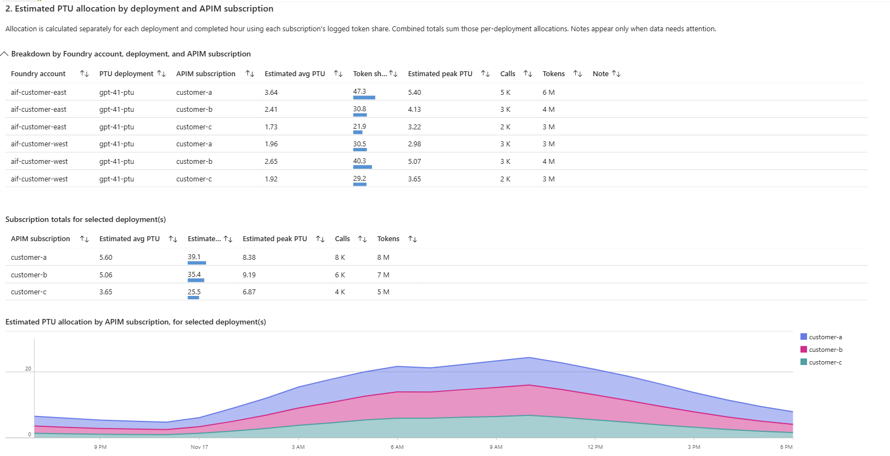

# Azure Foundry and APIM Monitoring

Native Azure Monitor Workbooks for understanding Foundry model utilization
alongside Azure API Management (APIM) traffic. The first workbook connects
Foundry accounts and PTU deployments to APIM subscriptions.

> This workbook is not a billing report or a Microsoft-supported product.
> Validate the results in your environment before operational or
> financial use.

## Workbook

**PTU usage by APIM subscription** shows:

- Foundry account and deployment behind each APIM subscription
- Calls and tokens observed in APIM logs
- Provisioned-managed deployment utilization from Azure Monitor metrics
- Estimated average and peak PTU allocation by subscription, in a table and
  chart

Select one or more Foundry accounts, every APIM instance serving them, and a
deployment to view its subscription breakdown. The combined view summarizes
the selected deployments.

**[Set up the workbook](docs/setup.md)** to connect your own Foundry accounts
and APIM logs.

## See it in action

*Example data: Screenshots use generated values, not measured customer usage
or a throughput guarantee.*

### Deployment utilization

Compare provisioned PTU capacity with average and peak utilization, and see
how utilization changes throughout the day.

### PTU allocation by subscription

See each subscription's calls, tokens, and estimated PTU allocation for each
deployment, followed by combined subscription totals and the allocation trend.
Estimates use each subscription's share of logged tokens, not directly metered
capacity consumption.

**[Set up the workbook with your Azure resources](docs/setup.md)**, or follow
the quick start below.

## Quick start

1. Follow the [setup guide](docs/setup.md) to verify APIM logging, Foundry
   metrics, and access.
2. Import
   [`workbooks/PTU-usage-by-APIM-subscription.workbook.json`](workbooks/PTU-usage-by-APIM-subscription.workbook.json)
   into **Azure portal > Monitor > Workbooks > + New > Advanced editor**.
3. Apply the JSON and save the workbook in a resource group. Select the Log
   Analytics workspace, Foundry accounts, APIM instances, and time range in the
   workbook.

The workbook runs natively in Azure Workbooks. There is no customer-side
script, exporter, scheduler, custom table, or deployment to install. It reads
APIM logs and Foundry metrics; saving the workbook creates the Workbook
resource itself.

## How the estimate works

Foundry reports utilization per deployment, not per APIM subscription. For
each deployment and time bucket, this workbook allocates measured utilization
to APIM subscriptions according to their share of logged tokens. This is an
estimate, not a direct measurement of each subscription's capacity
consumption.

## Important limitations

- Direct, unlogged, or incompletely sampled traffic can distort the
  token-share allocation. Include every APIM instance serving the selected
  deployments and review the workbook's **Data check** section.
- Historical capacity and deployment-change completion times cannot be
  reliably reconstructed. Do not rely on estimates around deployment changes
  or deleted deployments without independent verification.
- Backend URLs must identify a selected Foundry account and deployment.
  Proxies, custom backends, and rewritten paths may not be identifiable.
- APIM subscription IDs may not be customer names; map them separately if
  needed.
- The workbook supports up to five Foundry accounts. Large inventories or long
  time ranges may encounter Azure Monitor query limits.

## Validation

The workbook was exercised in a test environment with real APIM traffic across
two Foundry accounts and two APIM subscriptions. All four account/subscription
estimates matched independent calculations for a completed hour, and the per-deployment
and combined table and chart query results matched. This validates that test
scenario, not every customer topology; review the data checks and verify
results in your environment.
