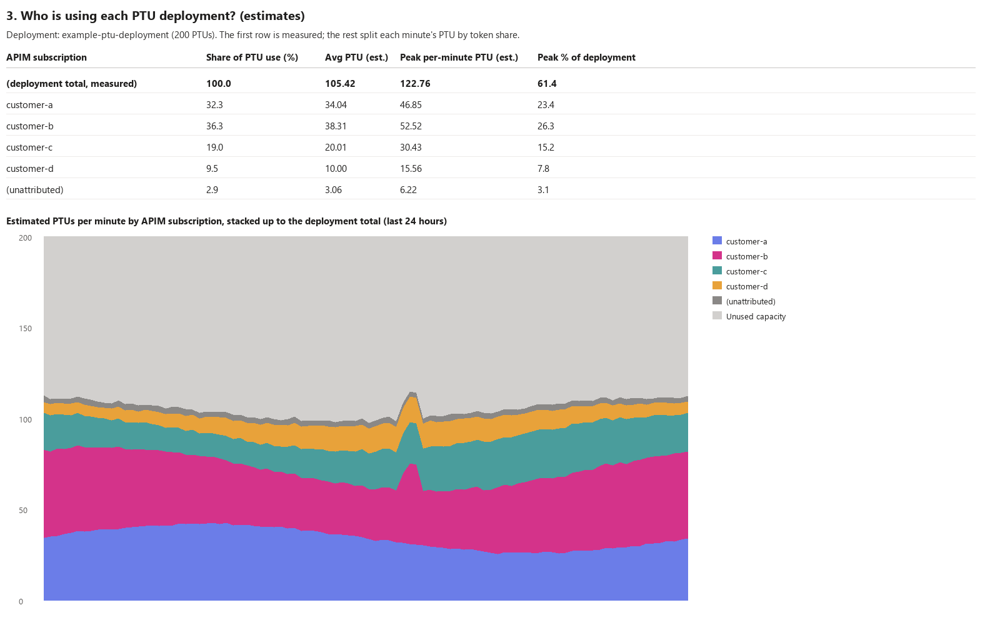
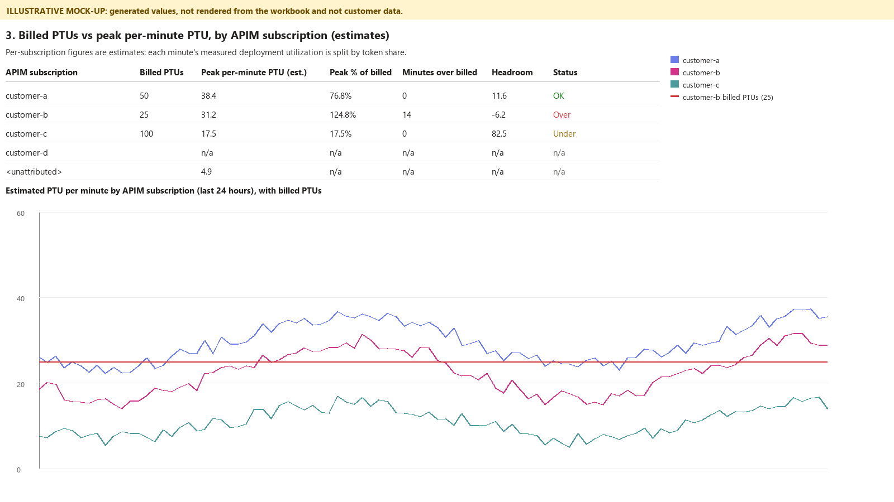

# Azure Foundry and APIM Monitoring

Native Azure Monitor Workbooks for understanding Azure OpenAI and Microsoft
Foundry model utilization alongside Azure API Management (APIM) traffic. The
first workbook connects model resources and PTU deployments to APIM subscriptions.

> Subscription PTU figures are estimates, not a billing report. Validate the
> results in your environment before operational or financial use.

## Workbook

**PTU usage by APIM subscription** shows:

- Azure OpenAI or Foundry resource and deployment behind each APIM subscription,
  when the backend URL or the APIM LLM log (deployment or model name) identifies them
- Calls and tokens observed in APIM logs
- Provisioned-managed deployment utilization from Azure Monitor metrics
- Estimated average and peak PTU allocation by subscription, in a table and
  chart
- PTU-hours for the selected range: used and capacity per deployment, and an
  estimated total per subscription (average PTU in use x hours). Subscription
  totals only cover hours that could be safely allocated.

- Peak per-minute PTU per subscription (estimated): the highest estimated PTU
  in any single minute of the selected range, with the hourly peak kept as a
  separate, relabeled column.
- Who uses each PTU deployment: for a shared deployment, each subscription's
  share of PTU use, average and peak per-minute PTU, and peak as a % of the
  deployment, next to the measured deployment total, plus a stacked per-minute
  chart that shows unused capacity.
- Billed-PTU comparison: enter a default purchased PTU amount for every client
  (and optional `name=PTUs` overrides) to see peak % of billed, minutes and %
  of minutes over billed, headroom, and an Under / OK / Over status, plus a
  per-minute chart with billed PTUs as a reference line.

Select one or more Azure OpenAI or Foundry resources, every APIM instance
serving the deployments, and a deployment to view its subscription breakdown.
The combined view summarizes the selected deployments. Select the resource
that hosts the deployment, not a Foundry project or PTU reservation.

**[Set up the workbook](docs/setup.md)** to connect your model resources and
APIM logs.

The workbook displays its version at the top. The current release is
[v1.1.1](https://github.com/michael-rechani/azure-foundry-apim-monitoring/releases/tag/v1.1.1);
see [releases](https://github.com/michael-rechani/azure-foundry-apim-monitoring/releases)
for other versions. Existing saved workbooks do not update automatically.

## See it in action

*Example data: These images are illustrative mock-ups with generated values, not
rendered from the workbook or from real usage, and not a throughput guarantee.*

### Who is using each PTU deployment

New in v1.1.0. When clients share one PTU deployment, see each subscription's
share of PTU use, average and peak per-minute PTU, and peak as a % of the
deployment, next to the measured deployment total. The chart stacks each
subscription's estimated PTUs per minute, and unused capacity fills the rest.

### Billed PTUs vs peak per-minute PTU

New in v1.1.0. Enter the PTUs each client bought (one default, plus optional
overrides) to compare it with that client's peak per-minute PTU. Because
clients share one deployment, "Over" means a client's estimated use exceeded
what it purchased, not that the deployment ran out of capacity.

## Quick start

1. Follow the [setup guide](docs/setup.md) to verify APIM logging, deployment
   metrics, and access.
2. Click **Deploy to Azure**, pick a subscription and resource group, and select
   **Review + create > Create**. This only saves the workbook; it does not touch
   APIM, Azure OpenAI, or Foundry resources. Each release deploys a new workbook
   named "PTU usage by APIM subscription (vX.Y.Z)", so your existing copies are
   not overwritten. Deploying the same version again to the same resource group
   updates that version's copy.

   

   Prefer to paste it yourself? Import
   [`workbooks/PTU-usage-by-APIM-subscription.workbook.json`](https://github.com/michael-rechani/azure-foundry-apim-monitoring/blob/v1.1.1/workbooks/PTU-usage-by-APIM-subscription.workbook.json)
   into **Azure portal > Monitor > Workbooks > + New > Advanced editor**, apply
   the JSON, and save it in a resource group.
3. Open the workbook and select the Log Analytics workspace, Azure OpenAI or
   Foundry resources, APIM instances, and time range.

The workbook runs natively in Azure Workbooks. There is no customer-side
script, exporter, scheduler, custom table, or deployment to install. It reads
APIM logs and deployment metrics; saving the workbook creates the Workbook
resource itself.

## Versioning

Each release is tagged and has a versioned deployment link. To prepare a new
release, update the workbook's displayed version and the versioned links in
this README and the setup guide, then run `python tools/build_arm_template.py`
and tag the resulting commit. Include a deployment link in the release notes.
Each release's link creates its own workbook named with that version, so a
newer release does not overwrite an older copy.

## How the estimate works

Azure Monitor reports utilization per deployment, not per APIM subscription.
For each deployment and time bucket, this workbook allocates measured
utilization to APIM subscriptions according to their share of logged tokens.
This is an estimate, not a direct measurement of each subscription's capacity
consumption.

## Important limitations

- Direct, unlogged, or incompletely sampled traffic can distort the
  token-share allocation. Include every APIM instance serving the selected
  deployments and review the workbook's **Data check** section. Unsafe buckets
  are excluded, so estimates may cover less than the selected time range.
- Historical capacity and deployment-change completion times cannot be
  reliably reconstructed. Do not rely on estimates around deployment changes
  or deleted deployments without independent verification.
- The provisioned deployment must expose the Azure Monitor
  **Provisioned-managed Utilization V2** metric. Not every Foundry model or
  endpoint is verified to support this workbook.
- The backend URL must identify a selected model resource, and either the URL
  or the APIM LLM log (deployment or model name) must identify the deployment.
  Foundry agent routes have no deployment in the URL, so they rely on the LLM
  log. Proxies, custom backends, and rewritten paths may not be identifiable.
- LLM log rows with no deployment, model, or tokens (for example speech or file
  APIs) are ignored. If no more than 5% of an hourly bucket's calls lack token
  usage, the bucket is allocated using the tokens that were logged; above 5% it
  is not allocated.
- APIM subscription IDs may not be customer names; map them separately if
  needed.
- Per-subscription PTUs are estimates: the deployment's measured utilization
  is split by token share, and token share is not the same as capacity use.
  The per-minute peak uses 1-minute utilization and APIM log timestamps (logged
  at request completion), so long or streaming calls can land in a neighboring
  minute. Minutes with utilization but no logged tokens appear under
  `<unattributed>`. The per-minute peak can be below the hourly peak when the
  per-minute window is shorter than the time range or token shares differ
  between the hour and its minutes; the Note column says so.
- The per-minute view covers the last **Per-minute window (hours)** (default
  24) of the time range, to stay within query-size limits. Widen it
  cautiously. The billed-PTU comparison uses one purchased value per
  subscription (a default plus optional overrides), summed across the selected deployments, and the Under/OK/Over
  thresholds are a convention (OK at or above the **'Under' below** % of
  billed), not a billing rule.
- The workbook supports up to five Azure OpenAI or Foundry resources. Large
  inventories or long time ranges may encounter Azure Monitor query limits;
  dropdowns are limited to 1,000 items.

## Data handling

The workbook only reads Azure Monitor metrics and Log Analytics data, and
needs Reader access. This repository is public: do not commit or post customer
data, IDs, keys, or screenshots from a real environment. See
[SECURITY.md](SECURITY.md).

## Support and license

This is a community sample, not a Microsoft-supported product. Report problems
or request changes by [opening a GitHub issue](https://github.com/michael-rechani/azure-foundry-apim-monitoring/issues). Released under
the [MIT License](LICENSE).
