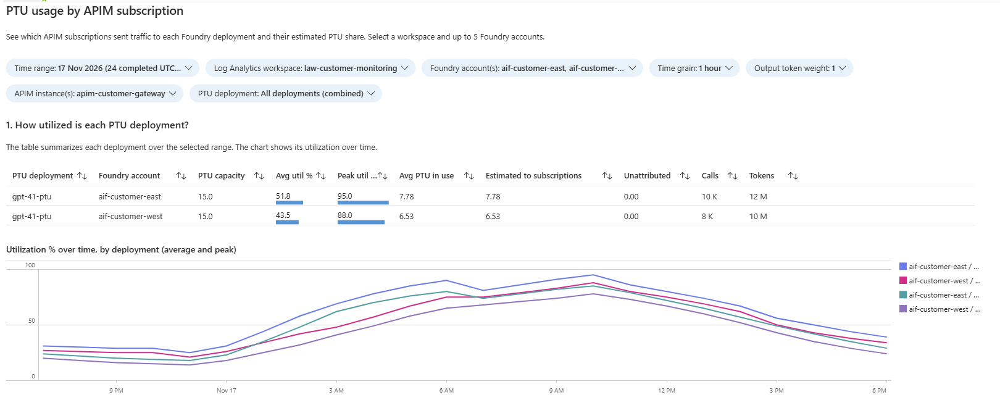

# Azure Foundry and APIM Monitoring

Native Azure Monitor Workbooks for understanding Azure OpenAI and Microsoft
Foundry model utilization alongside Azure API Management (APIM) traffic. The
first workbook connects model resources and PTU deployments to APIM subscriptions.

> Subscription PTU figures are estimates, not a billing report. Validate the
> results in your environment before operational or financial use.

## Workbook

**PTU usage by APIM subscription** shows:

- Azure OpenAI or Foundry resource and deployment behind each APIM subscription,
  when the backend URL or the APIM LLM log (deployment or model name) identifies them
- Calls and tokens observed in APIM logs
- Provisioned-managed deployment utilization from Azure Monitor metrics
- Estimated average and peak PTU allocation by subscription, in a table and
  chart

Select one or more Azure OpenAI or Foundry resources, every APIM instance
serving the deployments, and a deployment to view its subscription breakdown.
The combined view summarizes the selected deployments. Select the resource
that hosts the deployment, not a Foundry project or PTU reservation.

**[Set up the workbook](docs/setup.md)** to connect your model resources and
APIM logs.

## See it in action

*Example data: Screenshots use generated values, not measured customer usage
or a throughput guarantee. They show earlier Foundry-only labels; the picker
now says "Azure OpenAI or Foundry resource(s)".*

### Deployment utilization

Compare provisioned PTU capacity with average and peak utilization, and see
how utilization changes throughout the day.

### PTU allocation by subscription

See each subscription's calls, tokens, and estimated PTU allocation for each
deployment, followed by combined subscription totals and the allocation trend.
Estimates use each subscription's share of logged tokens, not directly metered
capacity consumption.

## Quick start

1. Follow the [setup guide](docs/setup.md) to verify APIM logging, deployment
   metrics, and access.
2. Click **Deploy to Azure**, pick a subscription and resource group, and select
   **Review + create > Create**. This only saves the workbook; it does not touch
   APIM, Azure OpenAI, or Foundry resources. Running it again with the same name
   and resource group updates the workbook in place.

   

   Prefer to paste it yourself? Import
   [`workbooks/PTU-usage-by-APIM-subscription.workbook.json`](workbooks/PTU-usage-by-APIM-subscription.workbook.json)
   into **Azure portal > Monitor > Workbooks > + New > Advanced editor**, apply
   the JSON, and save it in a resource group.
3. Open the workbook and select the Log Analytics workspace, Azure OpenAI or
   Foundry resources, APIM instances, and time range.

The workbook runs natively in Azure Workbooks. There is no customer-side
script, exporter, scheduler, custom table, or deployment to install. It reads
APIM logs and deployment metrics; saving the workbook creates the Workbook
resource itself.

## How the estimate works

Azure Monitor reports utilization per deployment, not per APIM subscription.
For each deployment and time bucket, this workbook allocates measured
utilization to APIM subscriptions according to their share of logged tokens.
This is an estimate, not a direct measurement of each subscription's capacity
consumption.

## Important limitations

- Direct, unlogged, or incompletely sampled traffic can distort the
  token-share allocation. Include every APIM instance serving the selected
  deployments and review the workbook's **Data check** section. Unsafe buckets
  are excluded, so estimates may cover less than the selected time range.
- Historical capacity and deployment-change completion times cannot be
  reliably reconstructed. Do not rely on estimates around deployment changes
  or deleted deployments without independent verification.
- The provisioned deployment must expose the Azure Monitor
  **Provisioned-managed Utilization V2** metric. Not every Foundry model or
  endpoint is verified to support this workbook.
- The backend URL must identify a selected model resource, and either the URL
  or the APIM LLM log (deployment or model name) must identify the deployment.
  Foundry agent routes have no deployment in the URL, so they rely on the LLM
  log. Proxies, custom backends, and rewritten paths may not be identifiable.
- LLM log rows with no deployment, model, or tokens (for example speech or file
  APIs) are ignored. If no more than 5% of an hourly bucket's calls lack token
  usage, the bucket is allocated using the tokens that were logged; above 5% it
  is not allocated.
- APIM subscription IDs may not be customer names; map them separately if
  needed.
- The workbook supports up to five Azure OpenAI or Foundry resources. Large
  inventories or long time ranges may encounter Azure Monitor query limits;
  dropdowns are limited to 1,000 items.

## Support and license

This is a community sample, not a Microsoft-supported product. Report problems
or request changes by [opening a GitHub issue](https://github.com/michael-rechani/azure-foundry-apim-monitoring/issues). Released under
the [MIT License](LICENSE).
